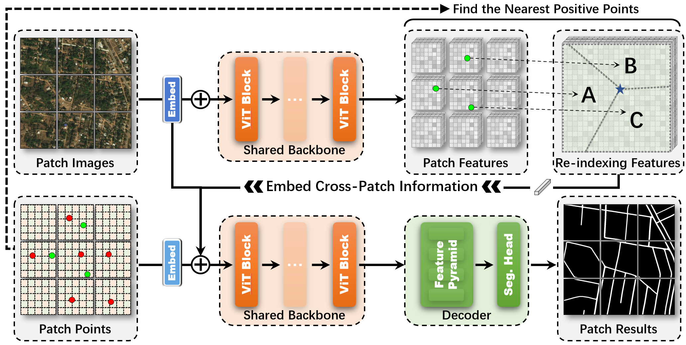

CrossCut (Jittor)
This is the official implementation for our AAAI 2026 Oral paper: "CrossCut: Cross-Patch Aware Interactive Segmentation for Remote Sensing Images".

The paper is available in the [AAAI 2026 proceedings](https://ojs.aaai.org/index.php/AAAI/article/view/37637).

# 📢 News
[2025-12]: The official code and pre-trained models are released!

[2025-11]: CrossCut is accepted by AAAI 2026 (Oral)!

# 🏠 Introduction
CrossCut is a novel interactive segmentation framework designed for remote sensing imagery. It introduces a cross-patch aware mechanism to handle remote image segmentation effectively.

<p align="center">
  
</p>


# 🛠️ Environment Setup

    ## Clone the repository
    git clone https://github.com/nanzhou02/CrossCut.git
    cd CrossCut
    
    ## Create a conda environment
    conda create -n crosscut python=3.8.8
    conda activate crosscut
    
    ## Install dependencies
    pip install -r requirements.txt

# 🚀 Usage
Before training and evaluation, please download the datasets and models, and then configure the path in config.yml.

1. Training

    We the ViT-B [SimpleClick](https://github.com/uncbiag/SimpleClick) model trained on COCO+LVIS datasets as our base model. (click to download: [ViT-Base](https://drive.google.com/file/d/10i-7TQh0o_L50S4VanEfZCJ5fpdjGTAo/view?usp=sharing)) 

    To train the model:

    python train.py models/iter_mask/plainvit_base448_crosscut.py \
    --weights=./weights/cocolvis_vit_base.pth \
    --ngpus=1 \
    --batch-size=2


2. Evaluation

    To evaluate with pre-trained model:

    python scripts/evaluate_model.py NoBRS --checkpoint=./weights/crosscut_jittor.pth --datasets=iSAID,DeepGlobe,Inria --merge --gpu=0 


## Download 
CrossCut jittor models: [Google Drive](https://drive.google.com/file/d/1csWJwG_E2u4vQ76drNwhZ8KtDEd_PrTH/view?usp=sharing)

Inria dataset : [Baidu Netdisk](https://pan.baidu.com/s/1ptksXulHCI8Kv3Ar5ek4Cg?pwd=3qdq) (Extraction code: `3qdq`)

DeepGlobe dataset : [Google Drive](https://drive.google.com/file/d/1U-4sTGeEQ8RN_Gqp-EiaU7i77I6mUVf7/view?usp=sharing)

iSAID dataset : [official site](https://captain-whu.github.io/iSAID/)


## License
The code is released under the MIT License. It is a short, permissive software license. Basically, you can do whatever you want as long as you include the original copyright and license notice in any copy of the software/source. 


## 📝 Citation
If you find our work useful, please cite our paper:

```bibtex
@article{lin2026crosscut,
  title   = {{CrossCut: Cross-Patch Aware Interactive Segmentation for Remote Sensing Images}},
  author  = {Lin, Zheng and Zhou, Nan and Wang, Yuhan and Zhang, Bojian},
  journal = {Proceedings of the AAAI Conference on Artificial Intelligence},
  year    = {2026},
  volume  = {40},
  number  = {9},
  pages   = {7024--7032},
  doi     = {10.1609/aaai.v40i9.37637},
  url     = {https://ojs.aaai.org/index.php/AAAI/article/view/37637}
}
```


## Acknowledgement
Our project is developed based on [RITM](https://github.com/saic-vul/ritm_interactive_segmentation). Thanks for the nice demo GUI :)


## 📧 Contact
For any inquiries, please contact: zhoun1468@gmail.com
